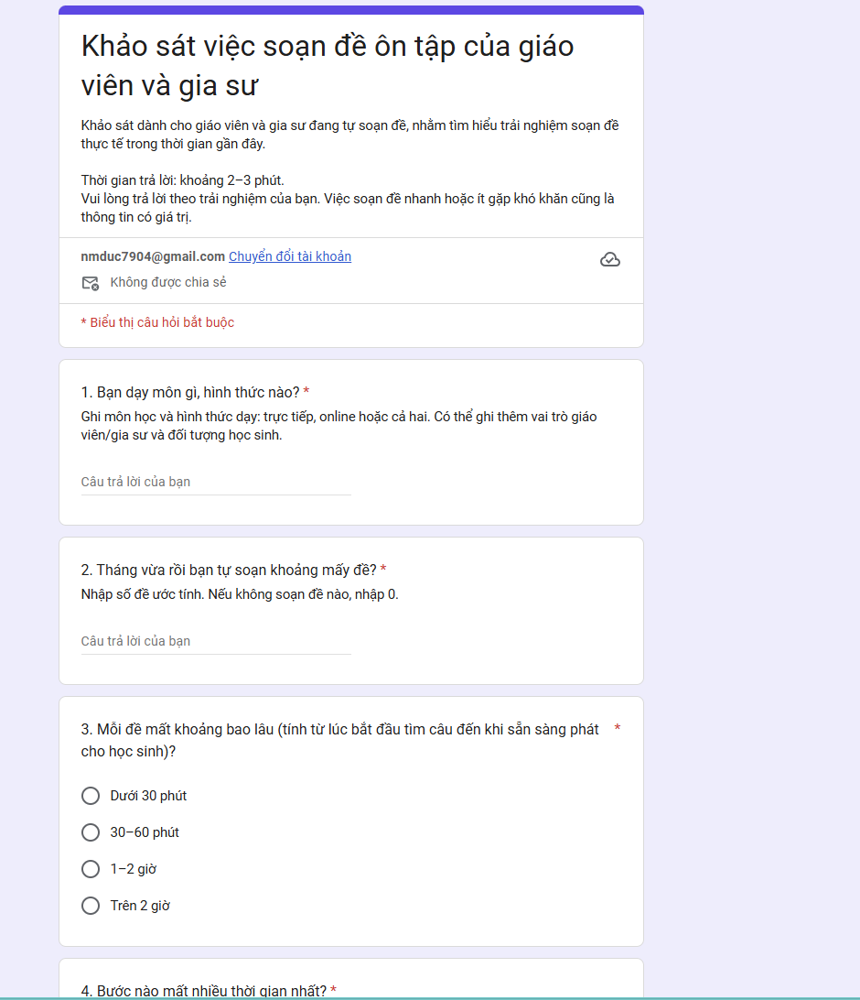

# Báo cáo cá nhân — 2A202603751_NguyenMinhDuc

> Template chi tiết và prompt mẫu cho từng mục: [docs/01-worksheet.md](../../docs/01-worksheet.md).

## 1. Thông tin học viên

- Họ tên: Nguyễn Minh Đức
- MSSV: 2A202603751
- Email trường (không bắt buộc, repo có thể để public):
- Tên nhóm: B2
- Link repo nhóm: https://github.com/shoxieje/K5-L3B-DAY02-B2-DiscoveryProblemFraming

---

## 2. Scan problem (CP1)

Lăng kính: **Lặp lại** · **Tốn thời gian** · **Cần đọc, tổng hợp nhiều thông tin** · **Pain từ người khác**.

Bối cảnh: tôi là gia sư dạy toán, dạy nhiều học sinh, phần lớn dạy và chấm bài online.

| # | Lăng kính | Job Story: Khi… tôi muốn… để… | Ai chịu ảnh hưởng? | Dấu hiệu thật (thời gian, tần suất, số người, bằng chứng) |
|---:|---|---|---|---|
| 1 | Lặp lại | Khi chuẩn bị đề ôn tập cho buổi học tới, tôi muốn có sẵn một đề mới đúng cấu trúc quen thuộc, để không phải dựng lại từ đầu mỗi lần dù cấu trúc đề năm nào cũng giống nhau | Gia sư (tôi), học sinh | 63–75 phút/đề (đã bấm giờ; ước tính ban đầu là 1–2 giờ); 3–5 đề/tuần, tức khoảng 3–6 giờ/tuần |
| 2 | Lặp lại | Khi hết ngày, tôi muốn biết hôm nay mình đã chi những khoản nào mà không phải nhớ lại và gõ tay vào bảng tính, để không quên khoản nào | Bản thân (tôi) | 15–20 phút/ngày cho việc ghi chép (khoảng 1,75–2,3 giờ/tuần; bản thân việc chi tiêu gần như không mất thời gian nên không tính); quên ghi 0–2 lần/tuần, có khi quên cả việc hôm nay đã chi những gì |
| 3 | Cần đọc, tổng hợp nhiều thông tin | Khi chấm xong bài online của một học sinh, tôi muốn xem nhanh điểm các buổi trước của em đó và có sẵn nhận xét, để gửi báo cáo bài tập cho phụ huynh mà không phải lật lại từng buổi | Gia sư, học sinh, phụ huynh | 3–5 phút/học sinh; 100 học sinh nhận xét mỗi tuần, tức khoảng 5–8 giờ/tuần |
| 4 | Tốn thời gian | Khi có file PDF đề sẵn cần đưa lên hệ thống thi online, tôi muốn có từng câu hỏi đã tách riêng và đã phân loại, để dựng đề nhanh thay vì nhập tay từng câu | Gia sư (tôi) | 30–45 phút/đề; mỗi đề 20–30 câu; 15–20 lần/tháng, tức khoảng 7,5–15 giờ/tháng |
| 5 | Pain từ người khác | Khi phụ huynh nhắn qua Zalo hỏi lịch học, học phí, điểm thi hoặc điểm danh của con, tôi muốn trả lời đúng ngay mà không phải tra từng nơi, để phụ huynh nắm tình hình và tôi không bị gián đoạn việc đang làm | Phụ huynh, gia sư (tôi) | 5–10 phút/phụ huynh/lần hỏi (phải tra lịch học, học phí, điểm thi, điểm danh ở các nơi khác nhau); khoảng 10 phụ huynh hỏi mỗi tuần, tức khoảng 50–100 phút/tuần |

**Nếu có dùng AI để gợi ý thêm:** ý nào AI gợi ý mà bạn giữ lại, ý nào bỏ và vì sao.

- Tôi tự nghĩ ra 4 ý đầu (#1–#4). Đến ý thứ 5 tôi hết ý, nên nhờ AI gợi ý thêm 6 tình huống (A–F) trong bối cảnh gia sư.
- **Giữ lại: ý A** (phụ huynh hỏi lại lịch học, bài tập, điểm qua Zalo). Đây là dòng #5 ở trên; phần tình huống thực tế (phụ huynh hỏi cả học phí, điểm thi, điểm danh) là do tôi tự bổ sung. Giữ vì tôi thật sự gặp việc này và nó là ý duy nhất thuộc lăng kính "Pain từ người khác" mà 4 ý đầu còn thiếu. Ý này **xuất phát từ gợi ý của AI**, tôi đã viết lại theo trải nghiệm của mình.
- **Bỏ:** B (nhắc học sinh nộp bài), C (đổi lịch dạy bù), D (tìm lại đề cũ trong Drive), E (tổng hợp lỗi sai lặp lại của từng em), F (nhắc và theo dõi học phí). Bỏ vì cần chọn một ý để kiểm chứng cho đúng, và các ý này nằm cùng cụm với dòng #1, #3 hoặc chưa có dấu hiệu thật đo được của tôi.

---

## 3. Top 3 Problem Cards + quy trình nháp (CP2)

> Đối chiếu số thứ tự với báo cáo nhóm (`group_report.md` mục 2.1): Card #1 (soạn đề ôn tập) của tôi là candidate **#4**, Card #2 (ghi chép chi tiêu) là **#5**, Card #3 (tách câu hỏi từ PDF) là **#6**. Mục 3 này là bản nháp CP2 trước khi nhóm kiểm chứng.

### Bảng chọn top 3

| Rank | Problem | Vì sao chọn | Điều còn chưa chắc |
|---:|---|---|---|
| 1 | Soạn đề ôn tập (#1) | Lặp lại mỗi tuần; 63–75 phút/đề, 3–5 đề/tuần (khoảng 3–6 giờ/tuần); quy trình 4 bước (1a, 1b, 2, 3) rõ ràng; cấu trúc đề cố định nên đo được | Giáo viên khác có mất cỡ 63–75 phút/đề không hay chỉ riêng tôi? Ngân hàng câu hỏi lấy từ đâu, có vướng bản quyền không? SmartTest đã giải được bao nhiêu phần của bước 1? |
| 2 | Ghi chép chi tiêu cuối ngày (#2) | Lặp lại hằng ngày; 15–20 phút/ngày; quy trình rõ; pain có thật (quên khoản chi 0–2 lần/tuần) | Chi tiền mặt không có dữ liệu thì Rule hay AI đọc từ đâu? Có sẵn lòng ghi ngay lúc chi không, hay vẫn để cuối ngày? Hiện chỉ có dữ liệu của riêng tôi |
| 3 | Tách và phân loại câu hỏi từ PDF (#4) | Lặp lại 15–20 lần/tháng; khoảng 7,5–15 giờ/tháng; quy trình rõ; hiện làm hoàn toàn thủ công | PDF đề có công thức toán thì tách đúng được không? Rule hay AI mới đủ? |

### Problem Card #1

| Trường | Nội dung |
|---|---|
| Job Story | Khi đến lớp cần cho học sinh ôn tập, tôi muốn có sẵn một đề đúng cấu trúc quen thuộc với các câu hỏi đã chọn, để không phải mất hơn một giờ tìm câu hỏi và tổng hợp lại cho mỗi đề |
| Actor | Gia sư dạy toán online soạn đề ôn tập cho học sinh (dữ liệu thật hiện là của một gia sư; việc giáo viên ở trường có quy trình tương tự là giả định cần kiểm chứng) |
| Thời điểm / bối cảnh | Trước các buổi học cần cho học sinh ôn tập (khoảng 3–5 đề/tuần), trước khi vào lớp; cấu trúc đề năm nào cũng giống nhau |
| Quy trình hiện tại (3–7 bước) | 1a. Tìm đề thi trên mạng (15') · 1b. Chọn các câu hỏi phù hợp với bài học từ các đề tìm được (15') · 2. Tổng hợp thành đề: copy về và gõ tay lại trên Word (30') · 3a. Nhập đề lên trang online (15') hoặc 3b. In ra phiếu để học sinh làm (3–5') |
| Bottleneck (bước nào, mất bao nhiêu phút) | Bước 1 mất 30 phút/đề. Bước 2 cũng mất 30 phút nhưng tôi coi bước 1 là bottleneck chính vì bước 1b đòi hỏi tôi phải đánh giá từng câu có hợp bài học hay không, việc này không thể làm máy móc bằng template.|
| Impact (nếu không giải thì sao) | Khoảng 63–75 phút/đề (cộng các bước; ước tính ban đầu là 1–2 giờ); 3–5 đề/tuần, tức khoảng 3–6 giờ/tuần cho một gia sư dạy online. Khi soạn không kịp, tôi dùng lại đề cũ có sẵn trên mạng thay vì soạn đề mới. Hậu quả: học sinh đã làm đề đó rồi và đề không sát bài học. |
| Success metric (baseline → target) | Baseline: 63–75 phút/đề. Target: 15–20 phút/đề. Cách đo: bấm giờ từng bước mỗi lần soạn đề, tách nhánh 3a (nhập online, 75') và 3b (in phiếu, 63–65'). Căn cứ target: template và ngân hàng gắn nhãn bỏ bước gõ lại (bước 2, 30' xuống còn vài phút); công cụ hỗ trợ chọn câu rút ngắn bước 1 (30' xuống khoảng 10'); xuất đề theo định dạng nhập sẵn rút ngắn bước 3a (15' xuống vài phút). |
| Phương án không dùng AI | Làm sẵn template Word theo cấu trúc đề cố định và ngân hàng câu hỏi phân loại theo chủ đề, mỗi lần chỉ chọn câu bỏ vào template. Thay được bước gõ lại (bước 2, 30') và một phần bước chọn câu nhờ lọc theo chủ đề. Hạn chế: chi phí dựng và gắn nhãn ngân hàng ban đầu lớn so với 63–75 phút mỗi đề, và câu hợp bài học nằm ngoài nhãn vẫn phải chọn tay. Cũng có thể dùng công cụ có sẵn như SmartTest. |
| Giả thuyết về AI (nếu có) | AI nhận yêu cầu bằng ngôn ngữ tự nhiên (chủ đề, độ khó, cấu trúc đề), chọn câu từ ngân hàng hoặc nguồn có sẵn và chỉ soạn câu mới khi ngân hàng thiếu; gia sư kiểm tra từng câu và đáp án trước khi in hoặc upload |
| Cảm nhận nhanh | Chưa biết |

Cập nhật sau kiểm chứng của nhóm (CP4–CP6): sau survey 10 người, nhóm thu hẹp actor về gia sư/giáo viên chưa có ngân hàng câu hỏi gắn nhãn, đổi baseline thành trung vị 1–2 giờ/đề và target thành ≤ 30 phút/đề tính cả thời gian duyệt (báo cáo nhóm mục 3.2 và 7). Mức can thiệp chọn là Workflow có người duyệt (mục 6).

Quy trình nháp hiện tại:

```text
HIỆN TẠI — 63–75 phút/đề (3–5 đề/tuần)

[1a Tìm đề trên mạng: 15']  ┐ ← BOTTLENECK (1a + 1b = 30')
→ [1b Chọn câu hỏi phù hợp bài học: 15'] ┘
→ [2 Tổng hợp thành đề: copy, gõ tay lại trên Word: 30']
→ [3a Nhập đề lên trang online: 15']
   hoặc
  [3b In phiếu cho học sinh làm: 3–5']
```

### Problem Card #2

| Trường | Nội dung |
|---|---|
| Job Story | Khi cuối ngày cần ghi lại các khoản đã chi vào bảng chi tiêu, tôi muốn có sẵn danh sách khoản chi trong ngày kèm nội dung rõ ràng, để không mất 15–20 phút nhớ lại và không bỏ sót khoản nào |
| Actor | Cá nhân (tôi) tự quản lý chi tiêu hằng tháng bằng Excel |
| Thời điểm / bối cảnh | Cần quản lý chi tiêu mỗi tháng; trong ngày chi tiêu như bình thường, đến cuối ngày mới ghi chép lại vào Excel |
| Quy trình hiện tại (3–7 bước) | 1. Chi tiêu trong ngày (tiền mặt hoặc chuyển khoản), không ghi ngay · 2. Cuối ngày nhớ lại các khoản đã chi · 3. Xem lại các giao dịch chuyển khoản và xác định mỗi khoản là chi cho việc gì · 4. Nhập từng khoản vào Excel. Thời gian 15–20 phút/ngày chỉ tính cho việc ghi chép (bước 2–4); bước 1 gần như không mất thời gian nên không tính. |
| Bottleneck (bước nào, mất bao nhiêu phút) | Bước ghi chép cuối ngày: giao dịch chuyển khoản không ghi rõ nội dung nên không biết chi cho việc gì; chi tiền mặt thì đến cuối ngày quên đã dùng. Cả bước mất 15–20 phút/ngày. |
| Impact (nếu không giải thì sao) | 15–20 phút/ngày, khoảng 1,75–2,3 giờ/tuần; quên ghi khoản chi 0–2 lần/tuần, nên dữ liệu chi tiêu của tháng có thể thiếu khoản |
| Success metric (baseline → target) | Baseline: 15–20 phút/ngày. Target: 3–5 phút/ngày. Cách đo: bấm giờ phần ghi chép cuối ngày (bước 2–4) trong 7 ngày liên tiếp và so với baseline 15–20 phút/ngày; ghi số khoản quên mỗi tuần |
| Phương án không dùng AI | Rule (if/else): với giao dịch có cấu trúc rõ, ví dụ email thông báo của ngân hàng, dùng quy tắc if/else để đọc số tiền, thời gian, nội dung rồi tự đẩy vào Excel và phân loại theo từ khóa. Điều kiện: dữ liệu đầu vào phải có cấu trúc cố định. Rule không xử lý được chi tiền mặt (không có dữ liệu để đọc) và chuyển khoản không ghi nội dung. |
| Giả thuyết về AI (nếu có) | Một trong ba hướng: (a) AI đọc email thông báo giao dịch ngân hàng; (b) chụp hóa đơn rồi AI đọc; (c) ghi chú bằng giọng nói rồi AI tự phân loại khoản chi |
| Cảm nhận nhanh | Chưa biết |

Quy trình nháp hiện tại:

```text
HIỆN TẠI — 15–20 phút/ngày

[1 Chi tiêu trong ngày, không ghi ngay: không tính thời gian]
→ [2 Cuối ngày nhớ lại các khoản đã chi]       ┐ ← quên tiền mặt
→ [3 Xem giao dịch chuyển khoản, đoán nội dung] ┤ ← không rõ chuyển khoản gì
→ [4 Nhập từng khoản vào Excel]                 ┘
   Bước 2–4 tổng 15–20'/ngày (chưa đo riêng từng bước)
   ← BOTTLENECK: bước 2–3 (ghi chép cuối ngày)
```

### Problem Card #3

| Trường | Nội dung |
|---|---|
| Job Story | Khi có file PDF đề sẵn cần đưa lên hệ thống thi online, tôi muốn có từng câu hỏi đã tách riêng và đã phân loại, để dựng đề nhanh thay vì nhập tay từng câu |
| Actor | Giáo viên và gia sư tạo đề thi online từ file PDF đề có sẵn |
| Thời điểm / bối cảnh | Mỗi lần dựng đề thi online từ một file PDF; khoảng 15–20 lần/tháng; mỗi đề 20–30 câu. Hiện chưa có công cụ hay quy trình tự động nào hỗ trợ |
| Quy trình hiện tại (3–7 bước) | 1. Mở file PDF đề có sẵn · 2. Copy từng câu hỏi (lặp 20–30 lần/đề) · 3. Dán/upload từng câu lên form của hệ thống thi online · 4. Phân loại từng câu thủ công · 5. Kiểm tra đề trước khi dùng |
| Bottleneck (bước nào, mất bao nhiêu phút) | Bước 2–3: copy từng câu rồi đưa lên form, lặp lại 20–30 lần mỗi đề, ước tính chiếm 20–25 phút trong 30–45 phút/đề. Bước 4 (phân loại thủ công từng câu) ước tính 10–20 phút. |
| Impact (nếu không giải thì sao) | 30–45 phút/đề × 15–20 lần/tháng = khoảng 7,5–15 giờ/tháng chỉ cho việc nhập và phân loại câu hỏi |
| Success metric (baseline → target) | Baseline: 30–45 phút/đề. Target: 5–10 phút/đề. Cách đo: bấm giờ mỗi lần dựng đề trong 4 tuần và so với baseline |
| Phương án không dùng AI | Rule: nếu PDF có chữ chọn được và đánh số câu theo mẫu cố định (ví dụ "Câu 1.", "Câu 2."), dùng script/regex tách câu theo mẫu, rồi phân loại theo từ khóa (if/else). Hạn chế: không dùng được với PDF dạng ảnh scan, công thức toán không copy được thành chữ, hoặc đề không đánh số theo mẫu cố định |
| Giả thuyết về AI (nếu có) | AI đọc file PDF, tách từng câu hỏi (kể cả công thức), gán nhãn phân loại và xuất thành định dạng để đưa lên hệ thống; gia sư kiểm tra lại trước khi dùng |
| Cảm nhận nhanh | Workflow |

Quy trình nháp hiện tại:

```text
HIỆN TẠI — 30–45 phút/đề (15–20 lần/tháng, 20–30 câu/đề)

[1 Mở file PDF đề có sẵn: ngắn, gộp vào tổng]
→ [2 Copy từng câu hỏi: lặp 20–30 lần]  ┐ ← BOTTLENECK
→ [3 Đưa từng câu lên form online]       ┘   ước tính 20–25'
→ [4 Phân loại từng câu thủ công: ước tính 10–20']
→ [5 Kiểm tra đề: ngắn, gộp vào tổng]
```

### Card muốn pitch nhất

- Card số: #1 (soạn đề ôn tập)
- Vì sao: Việc này tốn thời gian và tốn chất xám nhất trong các card của tôi: mỗi đề mất 63–75 phút, 3–5 đề/tuần, và bước tìm và chọn câu hỏi (bottleneck) đòi hỏi phải đánh giá câu hỏi có phù hợp bài học hay không.
- Câu hỏi muốn nhóm phản biện: Nếu có công cụ soạn đề, thì ngân hàng câu hỏi lấy dữ liệu ở đâu, và phân loại câu hỏi như thế nào (theo chủ đề, độ khó hay dạng bài)?

### AI đã phản biện card thế nào

Phản biện Card #1 do AI đóng vai PM hoài nghi thực hiện. Tôi đọc từng điểm, cho biết có đồng ý không và đã sửa gì vào card.

| Điểm yếu AI chỉ ra | Đồng ý? | Đã sửa gì |
|---|---|---|
| 1. Chọn bước 1 làm bottleneck mà không có lập luận: bước 1 và bước 2 đều 30 phút; bước 1 còn gộp "tìm đề" với "chọn câu" | Đồng ý | Đã sửa: tách bước 1 thành 1a (tìm đề, 15') và 1b (chọn câu, 15'); ghi lý do chọn bước 1 là bottleneck vì 1b cần đánh giá câu có hợp bài học không, template không làm thay được. Lưu ý: bước 2 dài nhất theo phút (30'), nên bottleneck được chọn theo độ khó chứ không theo số phút |
| 2. Baseline mâu thuẫn: mục 2 và bảng top 3 ghi 1–2 giờ/đề, 3–10 giờ/tuần; card ghi 63–75 phút, 3–6 giờ/tuần. Khoảng 63–75 phút còn ghép hai nhánh loại trừ nhau (3a nhập online 75', 3b in phiếu 63–65') | Đồng ý | Đã sửa: chốt baseline 63–75 phút/đề từ thời gian tôi ghi nhận từng bước; đồng bộ số liệu ở mục 2, bảng top 3 và card; tách hai nhánh loại trừ nhau: nhánh 3a (nhập online) tổng 75', nhánh 3b (in phiếu) tổng 63–65' |
| 3. Metric chưa đo được: chưa có "cách đo"; baseline là cộng ước lượng từng bước, chưa bấm giờ; target 15–20 phút chưa có căn cứ giảm từ bước nào | Đồng ý | Đã sửa: ô "Cách đo" của Card #1 ghi rõ bấm giờ từng bước và tách hai nhánh; ghi căn cứ target 15–20': bước 2 giảm nhờ template, bước 1 giảm nhờ công cụ hỗ trợ chọn câu, bước 3a giảm nhờ xuất đề theo định dạng nhập sẵn |
| 4. Actor chưa cụ thể: "giáo viên và gia sư" nhưng dữ liệu thật chỉ là của tôi (gia sư toán dạy online); bước 3a/3b có thể chỉ đúng với tôi | Đồng ý một phần | Đã sửa: thu hẹp actor ở Card #1 và Problem Statement về gia sư dạy toán online; việc giáo viên ở trường có quy trình tương tự được ghi là giả định cần kiểm chứng ở CP4 |
| 5. Tần suất trong card tự mâu thuẫn ("mỗi buổi học hằng ngày" so với 3–5 đề/tuần); "đề kiểm tra" và "đề ôn tập" lẫn lộn; "cấu trúc đề giống nhau" chưa có ví dụ; chưa có tần suất dùng lại đề cũ | Đồng ý | Đã sửa: thống nhất "đề ôn tập" và 3–5 đề/tuần ở mục 2 và card. Ví dụ cấu trúc đề và tần suất dùng lại đề cũ được đưa vào bộ câu hỏi phỏng vấn ở CP4 (câu 7 và câu 11) để lấy từ người thật |
| 6. Phương án không dùng AI bị gạt quá nhanh: ngân hàng câu hỏi chính là thứ thay cho bước tìm đề (bottleneck) nhưng card lại ghi "chưa giải quyết việc tìm câu hỏi"; chưa so chi phí dựng ngân hàng với 63–75 phút mỗi đề; giả thuyết AI chưa nói sinh câu mới hay chọn từ nguồn có sẵn, và sai đáp án thì xử lý sao | Đồng ý | Đã sửa: ô "Phương án không dùng AI" nêu rõ ngân hàng và template thay được bước gõ lại, kèm chi phí dựng ngân hàng so với 63–75'/đề; ô "Giả thuyết về AI" nêu rõ AI chọn câu từ nguồn có sẵn và chỉ soạn câu mới khi thiếu, và gia sư kiểm tra từng câu và đáp án |

---

## 4. Tôi đã tham gia phần nào (CP3 → CP7)

| Hoạt động | Tôi đã làm gì? | Kết quả / ảnh hưởng tới bài nhóm |
|---|---|---|
| Pitch Problem Card | Pitch Card #1 (soạn đề ôn tập) cho nhóm | Nhóm chọn Card #1 của tôi làm candidate problem |
| Phản biện bài của bạn khác | Câu hỏi tôi đã đặt (theo bảng pitch ở báo cáo nhóm mục 2.1): (1) Với #1 của Đăng Quang (Git + chat): "Nếu dev commit code thử nghiệm/chưa chạy được hoặc lưu code ở local thì làm sao biết đó là tiến độ thật?" (2) Với #3 của Đăng Quang (nguyên liệu tủ lạnh): "Sinh viên ở trọ sao có tiền mua tủ lạnh thông minh, làm sao AI biết trong tủ có gia vị gì nếu không nhập tay?" (3) Với #8 của Ngọc Quang (tìm hỏi đáp cũ trên Discord): "Discord search có sẵn rồi, liệu semantic search của AI có thực sự tốt hơn khi từ khóa lỗi code rất cụ thể?" | Câu (3) cũng là câu tôi phải trả lời cho bài của mình: đã có công cụ nào giải rồi chưa (SmartTest). Tôi đưa vào research và vào bộ câu hỏi kiểm chứng (câu 5 và câu 6). Hai câu (1) và (2) là phản biện cho bài của Đăng Quang, không làm thay đổi bài của tôi |
| Nhận phản biện | Câu hỏi tôi nhận được (mục 2.1): với #4 (soạn đề) từ Đăng Quang: "Ngân hàng câu hỏi lấy từ đâu, và có vướng vấn đề bản quyền đề thi không?"; với #5 (ghi chi tiêu) từ Ngọc Quang: "Tiền mặt không có log số liệu thì AI đọc kiểu gì nếu người dùng lười ghi ngay lúc mua?"; với #6 (tách câu từ PDF) từ Đăng Quang: "Đề toán có nhiều công thức LaTeX/ảnh hình học, PDF scan thì script hay AI có bóc tách nổi không?". Ngoài ra còn câu từ một bạn trong nhóm (báo cáo nhóm mục 5): nếu cùng 1 ngân hàng câu hỏi được nhiều người dùng thì học sinh có thể biết trước đề | Tôi đã sửa gì: (1) Câu "học sinh biết trước đề": đề xuất khóa agent hoặc ngăn học sinh hỏi các câu trong đề đang được giao hoặc đang làm bài; sau đó bổ sung đánh flag các câu đã dùng trong một đề (nhóm học sinh, ngày dùng, loại đề) để không dùng lại nhầm câu cho cùng nhóm học sinh, đã đưa vào Boundary. (2) Câu bản quyền/nguồn câu hỏi: thành giả định 5 (nguồn câu hỏi hợp pháp, chưa kiểm chứng) và rủi ro Feasibility mức Cao ở báo cáo nhóm mục 3.1 và 8.1. (3) Câu công thức LaTeX/hình vẽ: thành tiêu chí đánh giá 4 "công thức hiển thị đúng" ở báo cáo nhóm mục 7. (4) Câu tiền mặt (card chi tiêu) đã ghi ở cột "Điều còn chưa chắc" của bảng top 3 |
| Chọn candidate problem | Card #1 của tôi được nhóm chọn | Cả nhóm làm tiếp CP4 đến CP6 với bài soạn đề; kiểm chứng bắt đầu bằng bộ câu hỏi phỏng vấn và survey cho Card #1  |
| Kiểm chứng / research | (1) Research: tìm các bài thảo luận về khó khăn khi soạn đề thi và tìm hiểu công cụ SmartTest (smarttest.vn) xem có giải bài giống Card #1 và Card #3 không. (2) Kiểm chứng: soạn bộ câu hỏi phỏng vấn (12 câu) và survey (7 câu) cho Card #1 theo Mom Test (có nhờ AI hỗ trợ, ghi ở mục 5), tạo Google Form và chạy survey: 10 giáo viên/gia sư trả lời ngày 09/11/2026 (ảnh form và ảnh kết quả ở `report/assets/`); Ngọc Quang tổng hợp kết quả. Phỏng vấn chưa thực hiện | Research cho thấy đã có công cụ trùng một phần với Card #1 (SmartTest có quản lý ngân hàng câu hỏi, dựng đề và tính năng AI tạo đề), nên cần xác định khoảng trống thật trước khi chọn mức can thiệp. Survey cho thấy pain có thật (4/10 người mất từ 1 giờ/đề) nhưng cả 3 người có ngân hàng câu hỏi đều soạn dưới 1 giờ, nên nhóm thu hẹp actor, thêm đo thời gian duyệt và giữ quyết định Not Yet |
| Quy trình nhóm | Cung cấp số đo quy trình hiện tại (baseline 63–75'/đề), tách bước 1 thành 1a/1b, viết quy trình hiện tại và tương lai: Rule (template Word, ngân hàng gắn tag, cờ câu đã dùng), AI hỗ trợ chọn và soạn câu, gia sư duyệt, phương án quay về là chọn tay từ ngân hàng | Quy trình trước/sau và bảng before/after ở `group_report.md` mục 4; hạn chế nhóm phải kiểm tra lại: các số "sau" là kỳ vọng, chưa đo |
| Problem Statement | Soạn Problem Statement v0 và v1. v0: actor là gia sư toán dạy online; metric 63–75' → 15–20'/đề đo bằng bấm giờ. v1 sau kiểm chứng: actor là gia sư/giáo viên chưa có ngân hàng câu hỏi gắn nhãn; metric trung vị 1–2 giờ → ≤ 30'/đề tính cả thời gian duyệt, thêm tỉ lệ câu phải sửa ≤ 30% và số lần phải dùng lại đề cũ; Boundary gồm không tự đưa đề cho học sinh, không dùng lại câu đã gắn cờ, không làm việc trực tiếp với học sinh, gia sư duyệt đáp án | Mục 5 và 7 ở `group_report.md` (bảng thay đổi v0 → v1 ở mục 7); Boundary có thêm cờ câu đã dùng sau câu hỏi "học sinh biết trước đề" |
| Mức can thiệp AI | Soạn bảng so sánh No AI / Rule / Workflow / Agent, AI Canvas và hai câu hỏi PAIR; lấy template hoặc SmartTest làm phương án không dùng AI để đối chiếu | Mục 6 ở `group_report.md`. Bản nháp đầu của tôi chọn Agent vì nghĩ số bước thay đổi theo từng yêu cầu. Ngọc Quang phản biện: ba tình huống (ngân hàng thiếu câu, câu trùng, gia sư đổi yêu cầu) đều biết trước nên viết được thành nhánh rẽ cố định. Nhóm đổi sang **Workflow** có người duyệt |
| Quyết định | Chấm 4 rủi ro Value / Usability / Feasibility / Viability và đề xuất ngưỡng dừng đo được bằng số phút soạn đề | Mục 8 ở `group_report.md`: quyết định Not Yet, cần kiểm chứng giá trị so với SmartTest bằng người thật trước khi xây |

Form survey được tạo theo bộ câu hỏi ở CP4:



---

## 5. Dùng AI

| Checkpoint | Tôi dùng AI để làm gì? | AI hữu ích ở đâu? | AI sai hoặc hời hợt ở đâu? | Tôi sửa gì bằng nhận định của mình? |
|---|---|---|---|---|
| CP1 Scan | Tự viết 4 problem trước. Sau đó nhờ AI viết lại thành Job Story, tính tổng thời gian, và gợi ý ý thứ 5 vì tôi hết ý | Nhắc tôi còn thiếu lăng kính "Pain từ người khác"; gợi ý ý A (phụ huynh hỏi lại qua Zalo) mà tôi thật sự gặp | AI gợi ý 6 tình huống dựa trên việc đoán nghề gia sư, không biết tôi có gặp thật không | Chỉ giữ ý A vì đúng thực tế; bỏ 5 ý còn lại; điền lại dấu hiệu thật bằng số của mình |
| CP2 Problem Card | Nhờ AI dựng khung Problem Card #1 từ lời kể của tôi, đề xuất phương án không dùng AI; giao một subagent AI đóng vai PM hoài nghi phản biện Card #1 (6 điểm yếu, xem bảng ở mục 3) | Chuyển ý "nhờ AI soạn đề" từ Job Story xuống ô giả thuyết về AI; đề xuất template Word + ngân hàng câu hỏi theo chủ đề | AI gộp "tìm đề" và "chọn câu" thành một bước khi tôi chưa nói rõ | Giữ phương án không dùng AI sau khi tự xem lại; tự chọn bước 1 làm bottleneck, tự đặt target 15–20 phút/đề |
| CP4 Research | (1) Nhờ AI tìm trên mạng các bài thảo luận về khó khăn khi soạn đề thi (tiếng Việt và tiếng Anh, gồm cả gia sư toán). (2) Nhờ AI đọc trang smarttest.vn xem có giải bài giống Card #1 và Card #3 không | (1) Tìm được nguồn về việc giáo viên phải soạn nhiều đề và đề xuất ngân hàng câu hỏi dùng chung (Tạp chí Giáo dục Việt Nam, giaoduc.net.vn), cùng khảo sát nước ngoài cho thấy phần lớn giáo viên tự tạo bài đánh giá và nói tốn thời gian (Instructure, GL Assessment). (2) Biết SmartTest có ngân hàng câu hỏi theo ma trận, dựng đề, trộn đề, nhập câu từ Word và có tính năng AI tạo đề, trùng khá nhiều với Card #1 | (1) Chưa có nguồn nào nói riêng về gia sư toán soạn đề mất bao lâu; một số khảo sát do hãng công nghệ tài trợ nên có thể thiên lệch. (2) Lần đầu AI ghi nguồn là "Giáo dục Online" nhưng khi kiểm lại không tìm thấy trang này; nguồn thật là Tạp chí Giáo dục Việt Nam (giaoduc.net.vn). Báo cáo gốc của Instructure không mở được, chỉ lấy được qua eSchool News. | Sửa nguồn thành GDVN, ghi rõ nguồn thứ cấp và độ lệch của từng khảo sát ở mục 7. |
| CP4 Kiểm chứng (survey) | Nhờ AI viết bộ câu hỏi phỏng vấn và survey cho Card #1 (soạn đề) theo Mom Test; sau đó tôi tạo Google Form 7 câu và chạy survey (10 người trả lời, 09/11/2026) | Có sẵn kịch bản 12 câu phỏng vấn và 7 câu survey hỏi về hành vi đã xảy ra, kèm cách ghi nhận. Các câu 3–5 (thời gian mỗi đề, bước tốn nhất, lần gần nhất dùng lại đề cũ) cho kết quả đếm được và giúp tách ra nhóm đã có ngân hàng câu hỏi | Câu 6 (công cụ đang dùng) để trả lời tự do nên phải đọc từng câu trả lời để biết ai đã có ngân hàng câu hỏi, không đếm tự động được. Bộ 12 câu phỏng vấn chưa dùng vì chưa phỏng vấn | Giữ nguyên 7 câu cho cả 10 người; số liệu theo ảnh kết quả survey, nhóm đối chiếu lại khi tổng hợp. Bộ 12 câu phỏng vấn giữ cho buổi phỏng vấn sau |
| CP5 Quy trình | Nhờ AI dựng khung bảng quy trình hiện tại và tương lai từ Problem Card #1, và tính bảng before/after | Tách rõ nhánh 3a (nhập online) và 3b (in phiếu) khi tính tổng thời gian; gợi ý ghi actor, input, output cho từng bước | Ước tính thời gian "sau" theo hướng lạc quan và coi như đã chắc, trong khi tôi chưa có số đo cho các bước mới | Ghi các số "sau" là kỳ vọng, giữ baseline là số tôi tự ghi nhận; thêm phương án quay về khi AI sai |
| CP5–6 Problem Statement | Nhờ AI lắp nội dung 6 trường từ Problem Card #1; nhờ một subagent AI chấm lại toàn bộ báo cáo theo rubric | Phát hiện mâu thuẫn số liệu giữa các mục và các ô còn trống | Bản nháp đầu chọn Agent với lập luận "số bước thay đổi theo từng yêu cầu", nghe hợp lý nhưng chưa kiểm; để trống các trường phụ thuộc quyết định nhóm | Sau phản biện của Ngọc Quang, tôi kiểm lại: ba tình huống (thiếu câu, trùng câu, đổi yêu cầu) đều biết trước nên đổi sang Workflow; viết lại bảng so sánh 4 mức và Boundary cho khớp, ghi lý do vì sao không cần Agent |
| CP6 Mức can thiệp / quyết định | Nhờ AI soạn bảng so sánh 4 mức, AI Canvas, tiêu chí đánh giá và chấm 4 rủi ro | Gợi ý đối chiếu với SmartTest để kiểm tra khoảng trống thật, và gợi ý quyết định theo bằng chứng | Dễ đánh giá Value cao vì thấy nhu cầu rõ trong dữ liệu của riêng tôi, trong khi SmartTest đã giải một phần và chưa có kiểm chứng đủ tin cậy | Chấm Value ở mức trung bình, chọn Not Yet và đặt điều kiện kiểm chứng bằng người thật trước khi quyết định xây |

---

## 6. Reflection (CP7)

Trả lời bằng trải nghiệm thật của bạn, tối thiểu 200 từ cho các câu 6.1–6.6 (không tính 6.7, câu này được chấm riêng ở tiêu chí C5). **Không dùng AI để viết thay.**

**6.1. Tôi học được gì khi nghe top 3 problems của các bạn khác?**
Điều đầu tiên tôi học được là cùng một nhóm nhưng pain nằm ở những chỗ rất khác nhau. Chín candidate của ba người trải từ công việc (soạn đề, điều phối dự án code) đến đời sống (chi tiêu, nấu ăn). Khi nhóm gom cụm ở mục 2.2, chúng lộ ra ba kiểu pattern: soạn và xử lý tài liệu giảng dạy (#4, #6), điều phối thành viên trong nhóm (#1, #9) và thông tin quan trọng nằm rải rác trong nhiều kênh (#7, #8, #2). Điều thứ hai là nghe người khác phản biện giúp tôi thấy lỗ hổng bài mình rõ hơn so với tự đọc lại. Câu hỏi của Đăng Quang "ngân hàng câu hỏi lấy từ đâu, có vướng bản quyền không" là điều tôi chưa từng nghĩ tới vì tôi quá quen với việc soạn đề. Điều thứ ba là một ý nghe hấp dẫn chưa chắc đã đáng làm. Ý ghi chi tiêu của tôi (#5) và ý nguyên liệu tủ lạnh của Đăng Quang (#3) đều rơi vào cluster D và bị loại khỏi cây OST, vì cả hai đều vướng ở khâu "lười nhập liệu đầu vào": tiền mặt không có log thì AI không có gì để đọc. Điều thứ tư là cách các bạn đặt câu hỏi, luôn hỏi "đã có Google Calendar chung, Discord search hay When2meet chưa". Tôi rút ra thói quen mới: trước khi nghĩ đến AI phải hỏi đã có phương án No AI nào làm được chưa. Cuối cùng, sự đa dạng của các problem cho tôi thấy AI có thể hỗ trợ ở rất nhiều chỗ trong công việc lẫn đời sống, nhưng chỉ ở những chỗ có quy trình rõ, có dữ liệu đầu vào và có người chịu thiệt thật.

**6.2. Nhóm có lúc nào bị "solution-first" (nghĩ giải pháp trước khi hiểu vấn đề) không? Lúc đó nhóm nhận ra và xử lý thế nào?**
Có, và tôi thấy ít nhất hai lần. Lần thứ nhất là ý tưởng dùng AI tổng hợp thông báo và deadline từ nhiều nguồn (candidate #7). Nhóm nghe thấy hợp lý nhưng chưa trả lời được hai câu: AI có thật sự cần thiết không, và áp dụng vào đây có khả thi không. Đăng Quang hỏi lại: nếu lớp trưởng lập một Google Calendar chung rồi ghim lên Discord thì đã giải quyết được chưa. Phương án No AI này gần như xử lý hết nhu cầu, nên #7 bị loại. Lần thứ hai là chính bài của tôi. Ngay trong Problem Card #1 tôi đã viết sẵn "giả thuyết về AI" khi mới đo được số phút của một mình tôi, và ở Card #3 tôi đã ghi "cảm nhận nhanh: Workflow" trước khi có bất kỳ kiểm chứng nào. Bản nháp mức can thiệp đầu tiên tôi còn chọn Agent chỉ vì nghe có vẻ mạnh. Nhóm nhận ra qua ba việc. Thứ nhất, khi dựng cây OST, nhóm gạch bỏ các ý là solution đội lốt opportunity như "Trợ lý AI tự sinh đề thi toán" và "Bot Discord tự trả lời bài lab", rồi viết lại thành nhu cầu thật ("tìm và chọn câu hợp bài học nhanh hơn"). Thứ hai, nhóm lập Assumption Map và nghiên cứu SmartTest, phát hiện đã có công cụ làm một phần việc này, kể cả tính năng "Tạo đề với AI". Thứ ba, nhóm chọn quyết định Not Yet thay vì lao vào xây, và ghi rõ điều cần kiểm chứng trước. Bài học của tôi: viết giả thuyết AI quá sớm làm mình ngừng hỏi "vấn đề có thật không".

**6.3. Tôi có đổi ý sau khi bị phản biện không? Kể một lần cụ thể.**
Có, tôi đổi ý hai lần. Lần thứ nhất là về cách người dùng tương tác. Khi tôi pitch ý tưởng soạn đề, có người hỏi rằng trên mạng đã có công cụ làm việc này, nhưng muốn tạo đề thì người dùng phải điền form với rất nhiều ô. Tôi từng nghĩ chỉ cần có công cụ là đủ. Câu hỏi đó cho tôi thấy khoảng trống có thể nằm ở trải nghiệm: gia sư muốn nói yêu cầu bằng ngôn ngữ tự nhiên ("ôn chương này, độ khó vừa, cấu trúc như đề cũ") thay vì điền form. Vì vậy tôi chuyển sang hướng giao diện chat, và bước 1 của quy trình tương lai ở mục 4.2 là gia sư nhập yêu cầu bằng ngôn ngữ tự nhiên. Lần thứ hai là về mức can thiệp. Bản nháp của tôi chọn Agent với lập luận số bước thay đổi theo từng yêu cầu. Ngọc Quang phản biện rằng ba tình huống chính (ngân hàng thiếu câu, câu trùng, gia sư đổi yêu cầu) đều biết trước nên viết được thành nhánh rẽ cố định. Tôi không đồng ý ngay mà tự liệt kê lại các tình huống, và thấy đúng là không tình huống nào cần AI tự quyết bước tiếp theo. Tôi đổi sang Workflow có người duyệt, và viết lại bảng so sánh 4 mức cùng ghi rõ lý do không chọn Agent. Việc đổi ý này làm bài đơn giản, dễ kiểm tra hơn và ít rủi ro đáp án sai hơn.

**6.4. Kết quả kiểm chứng (phỏng vấn/survey/research) có làm tôi bất ngờ không? Điều gì?**
Có, tôi bất ngờ ở ba điểm. Thứ nhất là tốc độ của những người có kinh nghiệm. Baseline 63–75 phút/đề của tôi cao hơn số đông: 6/10 người trả lời mất dưới một giờ mỗi đề, và cả ba người đã có ngân hàng câu hỏi đều soạn dưới một giờ (hai người dưới 30 phút). Tôi từng nghĩ "mất hơn một giờ" là chuyện chung của mọi người dạy học, nhưng thực ra phần lớn là do tôi chưa có ngân hàng câu hỏi. Điều này khiến nhóm thu hẹp actor và là lý do chính của quyết định Not Yet. Thứ hai là quan điểm về AI trong giáo dục chia làm hai luồng rõ rệt: có thầy cô hào hứng, có thầy cô không muốn dùng, và chỉ 1/10 người hiện đã dùng AI. Tôi từng mặc định giáo viên sẽ chào đón công cụ AI, nên điều này nhắc tôi rằng người dùng có thể không muốn giao việc chuyên môn cho AI, và vì vậy bước gia sư duyệt không phải thủ tục mà là điều kiện để họ chịu dùng. Thứ ba là gia sư Toán online duy nhất mất trên 2 giờ mỗi đề lại nói bước tốn nhất là dựng đề (công thức, hình vẽ), không phải chọn câu như tôi giả định. Desk research cũng làm tôi chững lại: nghiên cứu Elkins 2024 cho thấy thời gian viết quiz bằng AI gần bằng tự viết. Vì vậy nhóm đưa thời gian duyệt vào metric.

**6.5. Điều khó nhất khi viết Problem Statement là gì?**
Điều khó nhất là viết Success Metric, vì phần lớn con số tôi có ban đầu chỉ là giả định hoặc dữ liệu của riêng mình. Baseline 63–75 phút/đề là số tôi tự bấm giờ nên chỉ đại diện cho một gia sư dạy toán online. Khi có survey 10 người, câu thời gian lại trả lời theo khoảng (30–60 phút, 1–2 giờ) chứ không phải số phút, nên tôi không tính được trung bình chính xác mà chỉ nói được trung vị nằm ở khoảng 1–2 giờ. Target ban đầu 15–20 phút cũng khó bảo vệ vì chỉ dựa trên ước lượng của tôi về từng bước sau khi có công cụ. Khó thứ hai là phải chọn đúng cái để đo. Nếu chỉ đo thời gian tạo đề thì AI luôn trông tốt, nhưng nếu AI sai đáp án thì thời gian bị dồn sang khâu duyệt. Vì vậy ở v1 tôi đổi thành ba metric: tổng thời gian tính cả duyệt (từ trung vị 1–2 giờ xuống ≤ 30 phút), tỉ lệ câu phải sửa hoặc thay (≤ 30%) và số lần phải dùng lại đề cũ vì không kịp (về 0 trong 4 tuần pilot). Khó thứ ba là mọi con số "sau" ở mục 4 chỉ là kỳ vọng, nên tôi phải ghi rõ chưa đo, thay vì viết như đã chắc. Tôi rút ra rằng một metric tốt cần có baseline từ người thật, cách đo cụ thể và một ngưỡng dừng cụ thể, chứ không chỉ là một con số nghe đẹp.

**6.6. Nếu làm lại, tôi sẽ đổi gì? Tôi sẽ phản biện nhóm mạnh hơn ở điểm nào?**
Nếu làm lại, tôi sẽ đổi thứ tự làm việc. Trước tiên tôi sẽ hỏi người khác xem họ có thật sự gặp vấn đề này không, thay vì chỉ vì bản thân gặp vấn đề mà cho rằng giải pháp AI sẽ áp dụng được. Cụ thể, tôi sẽ chạy survey ngắn theo Mom Test ngay sau CP1, trước khi pitch ở CP3, để có số liệu từ người ngoài thay vì phải sửa baseline và actor ở CP6. Tôi cũng sẽ dùng thử SmartTest từ sớm để biết nó giải được bước nào, thay vì chỉ đọc trang chủ. Hiện thông tin về SmartTest vẫn dựa trên trang chủ và ghi chú trên lớp, và phỏng vấn 3 người đã chọn vẫn chưa thực hiện, nên tôi sẽ lên lịch phỏng vấn sớm hơn. Về phản biện, tôi sẽ đặt thẳng câu hỏi "ý tưởng này khác gì các giải pháp hiện có" ngay từ đầu, không đợi đến lúc đọc kết quả research. Tôi cũng sẽ phản biện mạnh hơn ở hai chỗ nhóm còn để mở: giả định số 6 (gia sư chịu duyệt từng câu và đáp án do AI đưa ra, chưa có bằng chứng) và điểm "Nhóm hiểu domain" của candidate #4 chỉ được 3/5 vì chỉ mình tôi làm gia sư. Với những điểm đó tôi sẽ đề nghị nhóm đặt ngưỡng dừng rõ hơn trước khi chốt Not Yet.

**6.7. Hiểu bài:**
Problem của nhóm là gia sư và giáo viên chưa có ngân hàng câu hỏi gắn nhãn mất từ 30 phút đến hơn 2 giờ cho mỗi đề ôn tập, và khi không kịp thì phải dùng lại đề cũ mà học sinh có thể đã làm; chưa nói đến giải pháp. Quy trình hiện tại gồm tìm đề (1a), chọn câu hợp bài học (1b), gõ lại trên Word (2) và nhập online hoặc in (3), trong đó pain nằm ở bước 1 (tìm và chọn câu, 30 phút/đề) vì cần phán đoán xem câu có hợp bài học hay không. Metric thành công là tổng thời gian mỗi đề tính cả thời gian duyệt giảm từ trung vị 1–2 giờ xuống ≤ 30 phút, kèm tỉ lệ câu phải sửa ≤ 30% và số lần dùng lại đề cũ về 0, đo bằng bấm giờ trong pilot 4 tuần. Boundary là AI không tự đưa đề cho học sinh, không đưa câu của đề đang giao hoặc câu đã gắn cờ cho cùng nhóm học sinh, và gia sư duyệt từng câu cùng đáp án rồi chịu trách nhiệm cuối cùng. Mức can thiệp chọn là Workflow có người duyệt: Rule lọc câu, áp template và xuất đề; AI chỉ chọn và soạn câu theo yêu cầu bằng ngôn ngữ tự nhiên; không cần Agent vì mọi nhánh đều biết trước, và chọn mức đơn giản nhất đủ dùng. Quyết định là Not Yet sau khi chấm 4 rủi ro: Value trung bình (SmartTest đã tồn tại, người có ngân hàng câu hỏi đã nhanh), Usability thấp (gia sư là chuyên gia, tự duyệt được), Feasibility cao (chưa có ngân hàng câu hỏi gắn nhãn, công thức toán, bản quyền), Viability trung bình (chi phí, bản quyền, ai vận hành). Ngưỡng dừng: nếu sau 4 tuần pilot thời gian vẫn trên 30 phút, hoặc phải sửa hơn 30% số câu, hoặc có đáp án sai lọt qua bước duyệt, thì quay về template Word cộng ngân hàng câu hỏi hoặc SmartTest.

---

## 7. Tài liệu tham khảo

Nguồn research (mở và kiểm ngày 09/11/2026):

1. SmartTest, trang chủ giới thiệu ngân hàng câu hỏi, tổ hợp đề theo ma trận, tạo nhiều mã đề hoán vị, nhập câu hỏi từ Word và tạo câu hỏi bằng AI: https://smarttest.vn
2. Tạp chí điện tử Giáo dục Việt Nam (GDVN), "Ngân hàng câu hỏi dùng chung cho kiểm tra, đánh giá học sinh cần đảm bảo yếu tố nào?" (nói ngân hàng dùng chung giúp giảm thời gian và công sức giáo viên xây dựng câu hỏi, đề kiểm tra): https://giaoduc.net.vn/ngan-hang-cau-hoi-dung-chung-cho-kiem-tra-danh-gia-hoc-sinh-can-dam-bao-yeu-to-nao-post263154.gd
3. eSchool News, "6 key trends shaping the future of K-12 assessment" (trích báo cáo *State of Assessment in K-12 Education* của Instructure: 84% giáo viên phải tự tạo bài đánh giá, hơn một nửa nói tốn quá nhiều thời gian; bài không nêu cỡ mẫu). Chưa mở được báo cáo gốc của Instructure, nên đây là nguồn thứ cấp và số liệu do hãng công nghệ giáo dục công bố: https://www.eschoolnews.com/district-management/2022/02/15/6-key-assessments-trends/
4. GL Assessment, *Crunched by Numbers*, mục "Workload: teachers have their say" (khảo sát YouGov năm 2019 khoảng 800 giáo viên và lãnh đạo ở Anh: giáo viên dành trung bình 6 giờ 48 phút mỗi tuần cho kiểm tra và đánh giá; 75% nói trường yêu cầu họ điều phối và giám sát đánh giá). Khảo sát do đơn vị bán bài đánh giá tài trợ nên có thể thiên lệch, số liệu thuộc năm 2019: https://www.gl-assessment.co.uk/reports/workload/yougov-results/

Framework và phương pháp (theo `docs/03-international-frameworks.md`, link đã mở được):

5. Intercom, "How we accidentally invented Job Stories" (Job Story, CP1–CP2): https://www.intercom.com/blog/accidentally-invented-job-stories/
6. Teresa Torres, "Opportunity Solution Trees" (Product Talk, CP3): https://www.producttalk.org/opportunity-solution-trees/
7. Rob Fitzpatrick, *The Mom Test* (CP4): https://www.momtestbook.com/
8. Google PAIR, *People + AI Guidebook*, chương "User Needs + Defining Success" (augment hay automate, CP6): https://pair.withgoogle.com/chapter/user-needs/
9. Anthropic, "Building effective agents" (phân biệt Workflow và Agent, CP6): https://www.anthropic.com/research/building-effective-agents
10. Marty Cagan, "The Four Big Risks" (SVPG, 4 rủi ro Value / Usability / Feasibility / Viability, CP6): https://www.svpg.com/four-big-risks/
